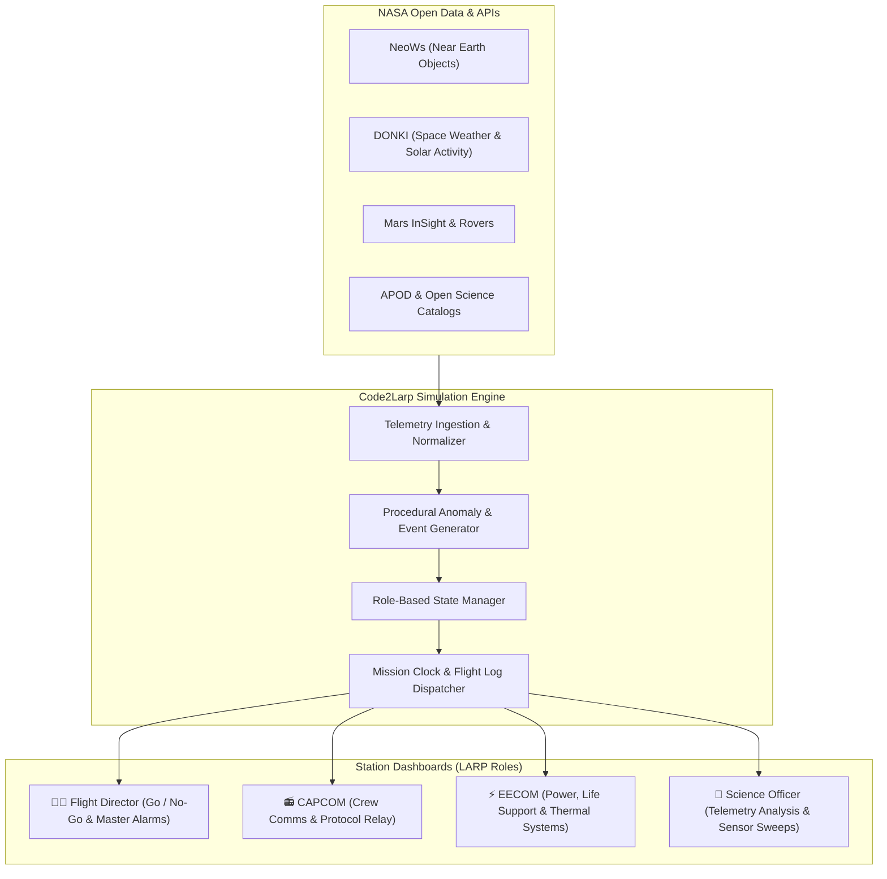

<div align="center">

# NASA Space Apps Challenge - Code2Larp
### *Transforming Real-Time Space Telemetry into Collaborative Mission Control Roleplay*

[](https://www.spaceappschallenge.org/)
[](https://opensource.org/licenses/MIT)
[](https://react.dev/)
[](https://www.typescriptlang.org/)
[](https://tailwindcss.com/)
[](https://vitejs.dev/)

[Project Pitch](#-project-overview) • [Key Features](#-core-features) • [System Architecture](#-system-architecture) • [NASA Data Integration](#-nasa-data-sources) • [Quick Start](#-quick-start) • [Team](#-team--credits)

---

</div>

## 🌌 Project Overview

**Code2Larp** is an interactive, gamified space mission simulator built for the **NASA Space Apps Challenge**. It bridges real-time astrophysics telemetry with live-action roleplaying (LARP) dynamics. 

Instead of passively reading static scientific charts, players step into synchronized operational roles inside a virtual **Mission Operations Control Room (MOCR)** or active orbital spacecraft. Real astrophysical events—such as solar particle storms, near-Earth asteroid approaches, and planetary weather fluctuations—dynamically inject mission anomalies that crew members must diagnose, communicate, and resolve in real time.

### 🎯 The Challenge & Mission
- **Data Accessibility:** Space telemetry from open science repositories can feel abstract to students, enthusiasts, and future engineers.
- **Human Connection:** Space exploration is fundamentally collaborative. Real spaceflight relies on disciplined crew resource management (CRM).
- **The Solution:** By framing real data ingestion inside a roleplay simulation framework, **Code2Larp** turns authentic NASA data streams into high-stakes, educational, and engaging team challenges.

---

## ✨ Core Features

| Feature | Description |
| :--- | :--- |
| **🎮 Role-Based Crew Operations** | Select your operational seat: **Flight Director**, **CAPCOM**, **EECOM (Electrical & Environmental)**, or **Science Specialist**, each with specialized telemetry panels and decision powers. |
| **🛰️ Live NASA Data Ingestion** | Integrates open NASA endpoints (NeoWs asteroid metrics, DONKI space weather reports, Mars weather indicators, APOD imagery). |
| **⚡ Dynamic Anomaly Engine** | Generates real-time mission alerts (e.g. coronal mass ejections, radiation spikes, telemetry loss) tied directly to live and historical space phenomena. |
| **📡 Mission Comms Log** | Operational flight log capturing decisions, timestamps, status clearances, and team communication in aerospace-standard syntax. |
| **📊 Real-Time Telemetry Gauges** | Interactive visual monitors tracking cabin atmospheric pressure, solar array power output, radiation exposure, and orbital trajectory. |

---

## 🏗️ System Architecture



---

## 🔭 NASA Data Sources & Open Science

Code2Larp is powered by open datasets provided by NASA:

| Dataset / API | Purpose in Simulation | Source Link |
| :--- | :--- | :--- |
| **Near Earth Object Web Service (NeoWs)** | Orbital proximity alerts, hazardous asteroid tracking, and trajectory calculations. | [NASA NeoWs API](https://api.nasa.gov/) |
| **Space Weather Database of Notifications (DONKI)** | Solar flare events, Coronal Mass Ejections (CMEs), and geomagnetic storm alerts affecting satellite electronics. | [NASA DONKI](https://api.nasa.gov/) |
| **Mars Exploration Data** | Atmospheric density and temperature telemetry for simulated planetary descent missions. | [NASA Mars Science](https://mars.nasa.gov/) |
| **Astronomy Picture of the Day (APOD)** | Mission briefing visual feeds and deep space sensor reconnaissance visuals. | [NASA APOD API](https://api.nasa.gov/) |

---

## 🛠️ Tech Stack

- **Framework:** [React 18](https://react.dev/) + [TypeScript](https://www.typescriptlang.org/)
- **Bundler & Build Tool:** [Vite](https://vitejs.dev/)
- **Styling:** [Tailwind CSS](https://tailwindcss.com/) with custom aerospace/sci-fi HUD design system
- **Icons:** [Lucide React](https://lucide.dev/)
- **Data Integration:** REST client with fallback telemetry cache for reliable offline presentations

---

## ⚡ Quick Start

### Prerequisites
- [Node.js](https://nodejs.org/) (version 18 or higher recommended)
- [npm](https://www.npmjs.com/) or [pnpm](https://pnpm.io/)

### Installation

1. **Clone the repository:**
   ```bash
   git clone https://github.com/venstqs/NASASpaceAppsChallenge---Code2Larp-.git
   cd NASASpaceAppsChallenge---Code2Larp-
   ```

2. **Install project dependencies:**
   ```bash
   npm install
   ```

3. **Configure Environment Variables:**
   ```bash
   cp .env.example .env
   ```
   *(Optional)* Replace `VITE_NASA_API_KEY=DEMO_KEY` with your free key from [api.nasa.gov](https://api.nasa.gov/).

4. **Launch the Development Server:**
   ```bash
   npm run dev
   ```
   Open `http://localhost:5173` in your browser to start the simulation.

5. **Build for Production:**
   ```bash
   npm run build
   ```

---

## 👥 Team & Credits

Developed with passion for the **NASA Space Apps Challenge 2026**.

- **Lead Developer & Creator:** Adrian Xavier Moral ([@venstqs](https://github.com/venstqs))
- **Team:** Code2Larp

### 🛰️ Disclaimer
*This project is submitted as an entry for the NASA Space Apps Challenge. NASA Space Apps Challenge is organized annually by NASA and its global partners. The project utilizes publicly accessible NASA open APIs under NASA Open Data policies.*

---

## 📜 License
This project is licensed under the MIT License.
