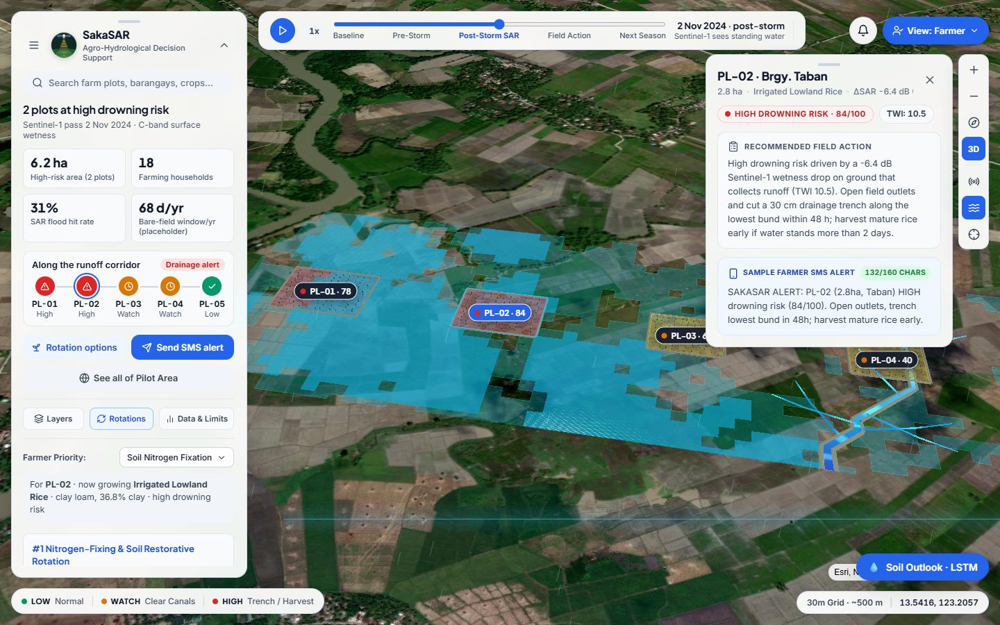
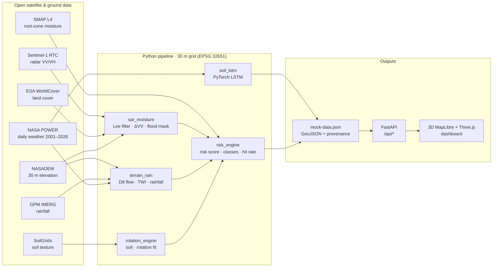

<div align="center">


# SakaSAR

### Radar-based field drowning risk and crop-rotation guidance for typhoon-hit farms

*Built for the 2026 NASA Space Apps Challenge — **Field Shift: Adapting Farms with NASA Data***

[](https://www.spaceappschallenge.org/)
[](https://www.spaceappschallenge.org/)
[](https://www.python.org/)
[](https://fastapi.tiangolo.com/)
[](https://maplibre.org/)
[](LICENSE)

### [▶ Open Live App on Vercel](https://sakasar.vercel.app) · [GitHub Pages Mirror](https://venstqs.github.io/SakaSAR---NASA-Space-Apps-Challenge/) · [Interactive API Docs](https://sakasar.vercel.app/docs)

**[Results](#-results-typhoon-kristine-october-2024)** ·
**[How it works](#%EF%B8%8F-how-it-works)** ·
**[Validation](#-validation)** ·
**[Run it](#-run-it-yourself)** ·
**[Methods](docs/METHODS.md)** ·
**[Team](#-team)**

</div>

---

## 🌾 In one minute

When a typhoon hits, **clouds blind optical satellites** exactly when farmers need to know which fields are flooding.
**Sentinel-1 radar sees through clouds.** SakaSAR compares radar images from before and after the storm,
adds NASA elevation, rainfall and soil-moisture data on one 30 m grid, and tells:

- **the farmer** which plot will drown first and what to do in the next 48 hours (plain language plus an SMS of 160 characters or fewer),
- **the Municipal Agriculture Office and MDRRMO** which barangays to visit first,
- **the cooperative** which of three next-season rotations fits each plot's soil and current crop,
- **everyone** how long the root zone will stay waterlogged (an LSTM trained on 25 years of NASA data).

Everything runs on **free, open data (₱0 licensing)** and is **reproducible from this repository**.

---

## 🧭 The problem

| Pain point | What SakaSAR does about it |
| :--- | :--- |
| Optical satellites (Landsat, MODIS) can't see the ground through typhoon clouds | Uses **C-band SAR (Sentinel-1)**, which penetrates clouds and rain |
| Damage surveys take weeks of field visits | Maps **35.1 ha of flooded farmland** for the pilot area in about a second from cache |
| Farmers get generic warnings, not plot-level actions | Gives each plot a **risk class, a 48-hour action and an SMS** |
| LGUs don't know where to send field teams first | **Ranks barangays** by high-risk farm area |
| After the flood, "what do we plant next?" | Rates **three rotations** against each plot's soil (SoilGrids), drowning risk and current crop |

---

## 📊 Results: Typhoon Kristine, October 2024

**Pilot:** rice paddies in Brgy. **Bagongbong, Taban and Catanusan, Minalabac, Camarines Sur** (Bicol River basin), about 9 km south of Naga City.
**Event:** Severe Tropical Storm Kristine (Trami), 21–26 October 2024.
**Radar:** Sentinel-1, relative orbit 134. Baseline = median of 4 calm passes (Aug–Sep 2024) · just before = 9 Oct · **after = 2 Nov 2024**.

| Demo number | Value |
| :--- | :--- |
| Plots rated **high** drowning risk | **2 of 5** (PL-01, PL-02) · 6.2 ha · 18 households\* |
| Flooded farmland observed by Sentinel-1 | **35.1 ha** in the pilot strip |
| **Hit rate:** share of flooded farmland the terrain + rain map had *already* rated high, without seeing the radar | **31%** |
| Barangay visit order | 1. Taban · 2. Bagongbong · 3. Catanusan |
| Storm rainfall, GPM IMERG (NASA POWER cross-check: 510 mm) | **497 mm** (event + 7 days prior) |
| SMAP root-zone soil moisture during the event | **+2.2σ** above the 30-day baseline |
| LSTM soil-saturation forecast, unseen 2022–2026 | **60%** lower error than persistence · Kristine: **7/7** waterlogged days |
| Data licensing cost · processing time | **₱0** · ~1 s from cache, 2–5 min with fresh downloads |

<sub>\* Plot outlines, hectares and households are illustrative sample values placed evenly on real farmland. The satellite measurements on them are real. See [Limits](#%EF%B8%8F-limits-and-what-we-do-not-claim).</sub>

| Farmer view: plot risk, 30 m risk zones, recommendations | LGU / MDRRMO view: barangay priority list |
| :---: | :---: |
|  |  |
| **Rotation fit versus the current crop** | **LSTM root-zone saturation outlook** |
|  |  |

<details>
<summary><b>Phone view</b> (the dashboard works on mobile)</summary>
<br>

</details>

---

## ⚙️ How it works



1. **Radar change (Sentinel-1).** 10 m RTC backscatter is averaged to 30 m and Lee-filtered. The change is
   `ΔVV = VV(2 Nov) − VV(baseline median)`. Calm floodwater acts like a mirror and turns the radar image dark.
2. **Observed flood.** A cell is flooded if it is dark (Otsu threshold), dropped by 2 dB or more, is flat (slope < 5°) and is not
   a permanent river or pond (WorldCover).
3. **Terrain (NASADEM).** Depression filling, then D8 flow accumulation, then the Topographic Wetness Index `TWI = ln(a / tan β)`,
   which shows where runoff collects.
4. **Rain (GPM IMERG).** Event plus 7-day antecedent total, cross-checked against NASA POWER.
5. **Risk score.** `round(100 × (0.45·S_SAR + 0.35·S_TWI + 0.20·S_Rain))`: **high ≥ 70**, **watch 40–69**, **low < 40**.
   Built-up and permanent-water cells are excluded, and cells without radar data are flagged as missing rather than scored.
6. **Rotation fit.** SoilGrids texture and drowning risk rate the legume, deep-rooting cover-crop and short-cycle
   options for each plot (for example, legumes are marked *caution* on waterlogged plots).
7. **LSTM outlook.** Forecasts root-zone saturation 1–7 days ahead from 30 days of NASA POWER weather plus the coming week's rain.
8. **Farmer recommendations.** Each plot gets a four-step timeline. **Next 48 h** comes from the measured risk, **this week**
   from the LSTM forecast after the 2 Nov pass, **before the next storm** from the LSTM's Kristine-scenario run on today's soil,
   and **next season** from the rotation fit. Every step names the data it comes from (`pipeline/recommend.py`).

**Why the 2 Nov pass and not the storm day?** The 21 Oct pass was taken at Kristine's peak. Typhoon wind roughened every
water surface: permanent water brightened by a median of +5.3 dB across a 35 × 33 km scan, so floodwater was invisible.
**Why Minalabac and not Naga City?** C-band cannot see water between buildings (the signal double-bounces off walls), so we
scanned the floodplain for farmland where the radar did see Kristine's water. The plots were then placed evenly, not hand-picked.
Full details: [`docs/METHODS.md`](docs/METHODS.md).

---

## ✅ Validation

| Check | Result | What it means |
| :--- | :--- | :--- |
| **Independent hit rate** | **31%** | The terrain + rain model rated 31% of the radar-observed flooded farmland *high* before seeing any radar data. |
| Full-model hit rate | 100% | Circular (the radar is on both sides). Reported only as a consistency check, never as the headline. |
| Pre-storm stability | +0.31 dB | 9 Oct vs the Aug–Sep baseline: the pre-storm fields were normal, so the change really comes from the storm. |
| Rainfall cross-check | 497 vs 510 mm | GPM IMERG and NASA POWER agree within 3%. |
| LSTM vs persistence (root zone) | −60% RMSE | Test years 2022–2026, never seen in training. In heavy-rain weeks (≥100 mm): −77%. |
| LSTM vs ridge regression (same inputs) | −25% RMSE | In heavy-rain weeks: −53%. Ridge is slightly better for day +1 only. |
| Kristine hindcasts | 7/7 · 7/7 | Waterlogged days predicted correctly in the storm week and after the 2 Nov pass. |
| Automated tests | 26 passing | Risk maths, D8 flow, Lee filter, contract, API, rotation rules, Guian's terrain package. |

---

## 🗂️ Our datasets

The pipeline also builds the team's own reusable, documented datasets (`python -m pipeline.build_datasets`):

| File | Rows | What it is |
| :--- | ---: | :--- |
| [`daily_weather_soil_2001_2026.csv`](data/datasets/daily_weather_soil_2001_2026.csv) | 9,444 | NASA POWER daily weather + root-zone/surface soil wetness at the pilot: the LSTM training set |
| [`pixels_30m_pilot.csv`](data/datasets/pixels_30m_pilot.csv) | 1,541 | Every 30 m cell: radar change, TWI, slope, land cover, **observed-flood label**, risk (full and terrain-only) |
| [`plot_features.csv`](data/datasets/plot_features.csv) | 5 | Per plot: radar, terrain, rain, SoilGrids soil, risk, rotation fit |
| [`plot_recommendations.csv`](data/datasets/plot_recommendations.csv) | 20 | The farmer recommendation timeline |

Column definitions, limits and source licences: [`data/datasets/README.md`](data/datasets/README.md). The datasets can also be
downloaded from the dashboard's **Data** tab.

---

## 🎯 Challenge alignment

| *Field Shift* asks for | SakaSAR delivers | Where |
| :--- | :--- | :--- |
| Use NASA Earth data to help farms adapt | NASADEM, GPM IMERG, SMAP and NASA POWER fused on one 30 m grid | `pipeline/` |
| Address extreme-weather impacts | Field drowning risk for a real typhoon, checked against observed flooding | Farmer view |
| Actionable guidance for farmers | Plot-level 48 h action, an SMS of 160 characters or fewer, and a 4-step recommendation timeline (radar + LSTM) | Plot card |
| Support adaptation decisions | Three ranked rotations versus the current crop, using soil and risk | Rotations tab |
| Serve local decision-makers | Barangay priority list for the MAO and MDRRMO | LGU view |
| Look ahead | LSTM root-zone saturation outlook with rain scenarios | Soil Outlook panel |

---

## 🛰️ Data

**NASA data used**

| Dataset | Resolution | Role |
| :--- | :--- | :--- |
| **NASADEM** | 30 m | Slope, D8 flow accumulation, TWI, drainage corridor |
| **GPM IMERG V07** | 0.1° (~10 km) | Event (469 mm) + 7-day prior (28 mm) rainfall → rainfall score |
| **SMAP L4 root-zone soil moisture** | ~11 km | Event anomaly (+2.2σ), shown at native resolution as context |
| **NASA POWER** | 0.5° · daily | Rainfall cross-check; 2001–2026 weather and `GWETROOT` to train the LSTM |
| *MODIS NDVI (checked, not used)* | 250 m | Too coarse to see bare paddies, so bare-field days stay a labelled placeholder |

**Partner and other data**

| Dataset | Provider | Role |
| :--- | :--- | :--- |
| **Sentinel-1 RTC (VV/VH)** | ESA / Copernicus via Microsoft Planetary Computer | Before/after radar, flood mask |
| **ESA WorldCover 2021** | ESA | Cropland / built-up / permanent-water mask |
| **SoilGrids 2.0** | ISRIC | Per-plot sand, silt, clay and organic carbon (0–30 cm) |

The clipped real data is cached in `data/cache/`, so the whole analysis re-runs offline. Raw team exports are in `data/raw/`.

---

## 🚀 Run it yourself

```bash
git clone https://github.com/venstqs/SakaSAR---NASA-Space-Apps-Challenge.git
cd SakaSAR---NASA-Space-Apps-Challenge
pip install -r requirements.txt

python -m pipeline.risk_engine        # full analysis from the cached real data (~1 s); --refresh re-downloads
uvicorn api:app --port 8000           # dashboard at http://localhost:8000  (add #outlook for the LSTM panel)
python -m pytest -q                   # 26 tests
```

<details>
<summary>More commands</summary>

```bash
python -m pipeline.sar_moisture        # Sentinel-1 stage only
python -m pipeline.terrain_rain        # terrain + rainfall stage only
pip install -r requirements-ml.txt     # PyTorch, to retrain the LSTM
python -m pipeline.soil_lstm           # retrain + evaluate the LSTM (~30 s on CPU)
python -m pipeline.build_datasets      # rebuild the CSV datasets in data/datasets/
python terrain_rain/scripts/run_all.py # Guian's terrain/rainfall package (works without WhiteboxTools)
```
</details>

### API

| Endpoint | Returns |
| :--- | :--- |
| `GET /api/data` | Full output: plots, flood extent, SAR layers, drainage corridor, rotations, provenance |
| `GET /api/plots` | Plot GeoJSON with risk, actions, SMS, soil and rotation fit |
| `GET /api/risk-map` | All map layers |
| `GET /api/rotations?priority=water\|nitrogen\|cash` | Rotations ranked by farmer priority |
| `GET /api/provenance` | Data sources, scene IDs, metrics, barangay ranking |
| `GET /api/soil-outlook` | LSTM hindcasts, scenarios and accuracy |
| `GET /api/recommendations?plot_id=PL-01` | Farmer recommendation timeline (all plots if no `plot_id`) |
| `GET /data/datasets/<file>.csv` | Download a dataset |
| `GET /docs` | Interactive OpenAPI documentation |

---

## 📁 Repository structure

```
├── pipeline/               # Adrian: core analytics
│   ├── sar_moisture.py     #   Sentinel-1 change detection and flood mask
│   ├── terrain_rain.py     #   NASADEM hydrology, IMERG/POWER rainfall, SMAP anomaly
│   ├── risk_engine.py      #   risk fusion, hit rates, barangay ranking → mock-data.json
│   ├── rotation_engine.py  #   SoilGrids profiles and per-plot rotation fit
│   ├── soil_lstm.py        #   PyTorch LSTM soil-saturation model
│   ├── recommend.py        #   per-plot farmer recommendation timeline
│   ├── build_datasets.py   #   builds the CSV datasets in data/datasets/
│   └── common.py           #   shared 30 m grid, data access, caching
├── terrain_rain/           # Guian: terrain & rainfall package (scripts, config, tests)
├── index.html · app.js · style.css · outlook.*   # Marqus: 3D dashboard (+ LSTM panel)
├── api.py                  # FastAPI server (API + dashboard)
├── data/                   # cached real inputs, raw exports, outputs, GeoTIFF layers
│   └── datasets/           #   our reusable CSV datasets + data card
├── models/soil_lstm.pt     # trained LSTM weights (82 KB)
├── docs/METHODS.md         # full method, validation and limits
├── docs/SUBMISSION.md      # submission form text
└── tests/                  # pytest suite
```

---

## ⚠️ Limits and what we do not claim

- **C-band radar measures surface wetness, not root-zone moisture.** Water under a tall rice canopy can brighten the signal
  instead of darkening it, so it can be missed.
- **The 2 Nov pass is 9 days after landfall:** it shows floodwater that stayed, not the peak.
- **Plot data is illustrative:** outlines, hectares, households, crops and bare-field days are sample values until there is
  LGU parcel and census data.
- **Risk weights (0.45 / 0.35 / 0.20) are expert-set, not fitted.** Calibrating them against damage reports is pilot work.
- **The LSTM learns NASA's regional soil model** (a ~50 km cell), not a paddy sensor.
- **Not claimed:** L-band dielectric inversion, "7 days early" detection, and "35–50% water saving". These came from the
  original concept but are not built or tested here.

## 🗺️ Roadmap

- **NISAR L-band** for deeper canopy penetration · **Sentinel-2 / Landsat 30 m NDVI** for real bare-field windows
- Real **LGU parcel and census data** in place of the sample plots
- **Calibrate the risk weights** against Municipal Agriculture Office damage reports
- A real SMS gateway, multi-municipality coverage and live monitoring after each new radar pass
- ECOSTRESS heat-stress alerts and GRACE groundwater trends

---

## 👥 Team

| Member | GitHub | Role |
| :--- | :--- | :--- |
| **Adrian Xavier Moral** | [venstqs](https://github.com/venstqs) | Main developer & integration lead: SAR pipeline, risk engine, LSTM, API |
| **Guian Emmanuel Beriso** | [Pudges-cmd](https://github.com/Pudges-cmd) | Terrain & rainfall pipeline: NASADEM, GPM IMERG, SMAP, NASA POWER |
| **Marqus Szymon Pelagio** | [mzep98](https://github.com/mzep98) | 3D MapLibre / Three.js dashboard, demo & submission |
| **Engr. John Roy V. Galvez** | — | Mentor |

## 🤖 Use of AI

AI coding assistants (**Anthropic Claude Code** and **Google Gemini in Antigravity**) helped with code scaffolding,
geospatial pipeline code, debugging, documentation and tests, and the team reviewed and ran all of it. The one machine-learning
model, a small PyTorch LSTM, was trained by the team on public NASA POWER data and evaluated on held-out years.
All satellite results are computed deterministically from open data. No AI-generated images or video are used, and no NASA logos
appear in AI-generated content.

## 📚 References

**Data:** [Sentinel-1 RTC](https://planetarycomputer.microsoft.com/dataset/sentinel-1-rtc) ·
[NASADEM](https://planetarycomputer.microsoft.com/dataset/nasadem) · [GPM IMERG](https://gpm.nasa.gov/data/imerg) ·
[SMAP L4](https://nsidc.org/data/spl4smgp) · [NASA POWER](https://power.larc.nasa.gov) ·
[ESA WorldCover](https://esa-worldcover.org) · [SoilGrids](https://soilgrids.org) ·
[MODIS MOD13Q1](https://lpdaac.usgs.gov/products/mod13q1v061/)

**Methods:** Lee (1980) speckle filter · Otsu (1979) thresholding · Beven & Kirkby (1979) Topographic Wetness Index ·
Barnes et al. (2014) priority-flood · Kratzert et al. (2018) LSTM rainfall–runoff modelling.
Full citations: [`docs/SUBMISSION.md`](docs/SUBMISSION.md#references).

**Software:** NumPy, SciPy, rasterio/GDAL, shapely, pyproj, FastAPI, PyTorch, MapLibre GL JS, Three.js, Lucide.

## 📜 License

[MIT](LICENSE) © 2026 SakaSAR team.
