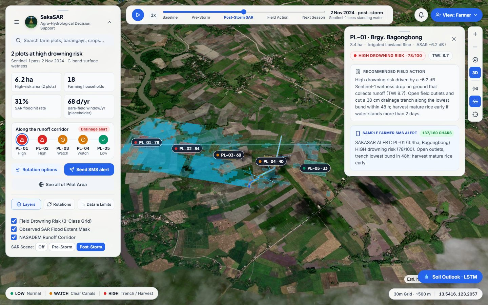
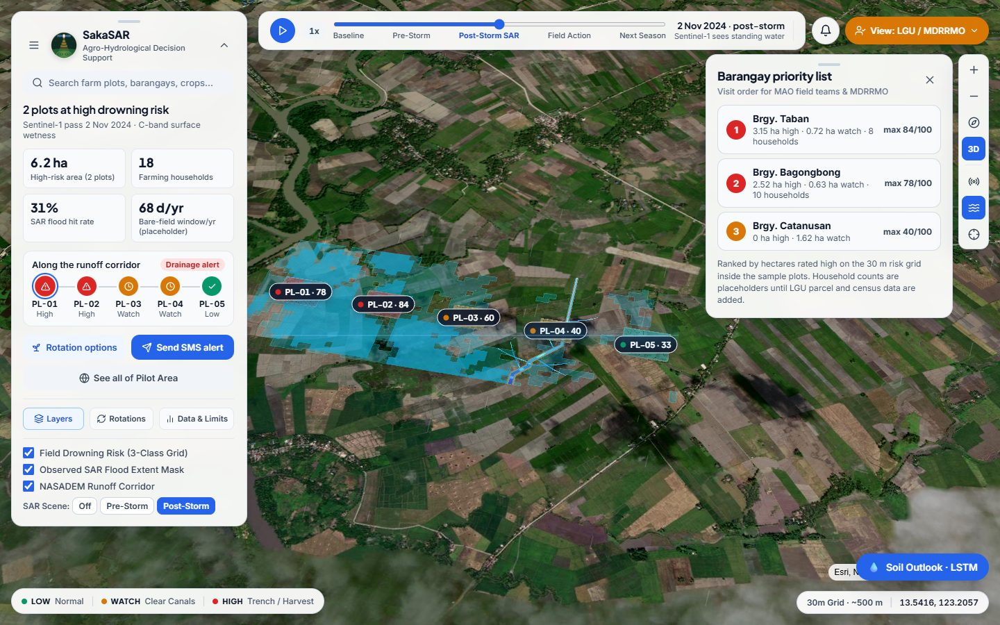
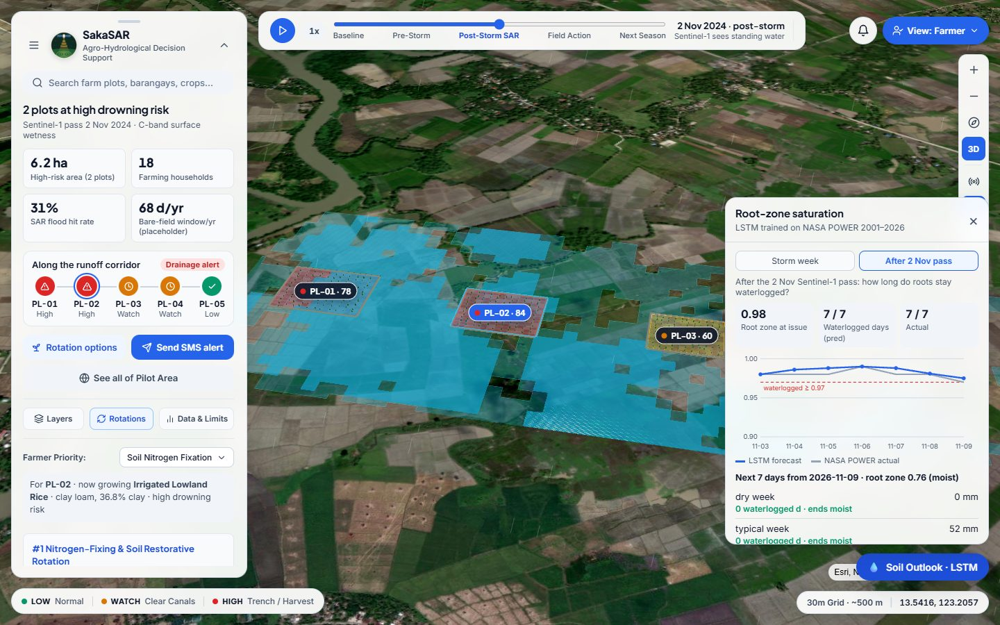

<div align="center">


# SakaSAR: Agro-Hydrological Decision Support
### *Sub-Surface Dielectric & Micro-Topographic SAR Analytics for Root-Zone Hydrology and Adaptive Crop Rotation under Extreme Weather Regimes*

[](https://www.spaceappschallenge.org/)
[](https://www.spaceappschallenge.org/)
[](https://www.python.org/)
[](https://fastapi.tiangolo.com/)
[](https://maplibre.org/)

</div>

---

## 🌍 Overview

**SakaSAR** is a cloud-penetrating agro-hydrological decision-support platform built for the **2026 NASA Space Apps Challenge** (*Field Shift: Adapting Farms with NASA Data*).

Optical satellite sensors (Landsat, MODIS) are blinded by cloud cover during typhoons and monsoon events—precisely when smallholder farmers need actionable flood and waterlogging intelligence. **SakaSAR** fuses **C-band Synthetic Aperture Radar (Sentinel-1 SAR)** backscatter shifts with **NASADEM 30 m micro-topography** and **NASA precipitation & agro-meteorology (NASA POWER / GPM IMERG)** on a shared 30 m grid to:

1. **Map Field Drowning Risk (`High` / `Watch` / `Low`)** across farm parcels and identify low-lying runoff channels where water pools.
2. **Validate Risk Against Observed SAR Flooding** by computing the independent spatial hit rate against post-storm standing-water masks.
3. **Rank Next-Season Crop Rotations** against the farmer's current baseline crop using bare-field windows, soil texture, and farmer priorities (*Water Conservation*, *Soil Nitrogen*, *Cash Income*).
4. **Deliver Plain-Language Advisories & $\le 160$-Character SMS Alerts** for smallholder farmers, cooperatives, agricultural extension officers, and Municipal DRRM Offices (MDRRMOs).

---

## 📊 Results: STS Kristine (Trami), October 2024

**Pilot:** rice paddies in Brgy. Bagongbong, Taban and Catanusan, **Minalabac, Camarines Sur** (Bicol River basin), about 9 km south of Naga City.
**Radar:** Sentinel-1 orbit 134. Baseline = median of 4 calm passes (Aug–Sep 2024), just-before = 9 Oct, after = **2 Nov 2024**.

| Demo number | Value |
| :--- | :--- |
| Plots rated **high** drowning risk | **2 of 5** (PL-01, PL-02) · 6.2 ha · 18 households *(hectares/households are illustrative until LGU data)* |
| Flooded farmland seen by Sentinel-1 | **35.1 ha** in the pilot strip |
| **Hit rate** (flooded area the terrain + rain map had *already* rated high, without seeing the radar) | **31%** |
| Barangay visit order (extension officers / MDRRMO) | 1. Taban · 2. Bagongbong · 3. Catanusan |
| Storm rainfall (GPM IMERG; NASA POWER cross-check 510 mm) | **497 mm** (event + 7 days prior) |
| SMAP root-zone soil moisture during the event | **+2.2σ** above the 30-day baseline |
| LSTM soil-saturation forecast (test years 2022–2026) | 60% lower error than persistence · Kristine hindcast: 7/7 waterlogged days |
| Data licensing cost · processing time | **₱0** · ~1 s from cache, ~2–5 min with fresh downloads |

| Farmer view | LGU / MDRRMO view |
| :---: | :---: |
|  |  |
| **Rotation fit vs current crop** | **LSTM soil-saturation outlook** |
|  |  |

Full method, validation and limits: [`docs/METHODS.md`](docs/METHODS.md).

---

## 🌿 Branch Architecture & Team Roster

Per our 12-hour engineering checklist, three developers work across **six isolated feature branches** (two each) and merge into `main` only at the verified hour gates:

| Branch | Owner | Deliverables |
| :--- | :--- | :--- |
| `feature/risk-engine` | **Adrian** *(Main Developer / Integration Lead)* | Shared 30 m grid, rule-based Field Drowning Risk score (`0–100`), per-plot & barangay statistics, independent SAR flood hit-rate validation, and FastAPI endpoints (`api.py`). |
| `feature/sar-moisture` | **Adrian** | Sentinel-1 VV/VH before & after storm passes, Lee speckle filter, 30 m grid alignment, $\Delta\sigma^0$ wetness-change layer, observed post-storm flood extent mask, and scene provenance. |
| `feature/terrain-rain` | **Guian** | NASADEM 30 m slope, priority-flood depression filling, D8 flow accumulation, Topographic Wetness Index ($\text{TWI}$), drainage corridor extraction, GPM IMERG / NASA POWER rainfall totals, and SMAP anomaly. |
| `feature/rotation-engine` | **Guian** | Multi-year NDVI series (bare-field windows & days/year), SoilGrids texture profile, and 3 rule-ranked crop rotation strategies with local verification notes. |
| `feature/dashboard` | **Marqus** | MapLibre GL JS floating GIS dashboard (`index.html`, `app.js`, `style.css`), 3-class risk symbology, before/after SAR toggle, plot action cards, and SMS alert preview. |
| `feature/demo-submission` | **Marqus** | Pilot event record, demo storyboard & deck/video, project page text, and final judging package. |
| *Hour-Gate Review* | **Engr. John Roy V. Galvez** | Monitors Hour 1, Hour 4, Hour 7, Hour 9 (Feature Freeze), and Hour 12 gates. |

### 👥 Team

| Member | GitHub | Role |
| :--- | :--- | :--- |
| **Adrian Xavier Moral** | [venstqs](https://github.com/venstqs) | Main developer & integration lead: SAR pipeline, risk engine, LSTM, FastAPI |
| **Guian** | [Pudges-cmd](https://github.com/Pudges-cmd) | Terrain & rainfall pipeline (`terrain_rain/`): NASADEM, GPM IMERG, SMAP, NASA POWER |
| **Marqus Szymoon Pelagio** | [mzep98](https://github.com/mzep98) | 3D MapLibre / Three.js dashboard, demo & submission |
| **Engr. John Roy V. Galvez** | — | Hour-gate reviewer |

---

## 🛰️ Datasets & Sensor Fusion Grid

### Datasets Used in the Build
| Dataset | Source / Agency | Resolution | Role in SakaSAR |
| :--- | :--- | :--- | :--- |
| **Sentinel-1 RTC (VV / VH)** | ESA / Copernicus (via Planetary Computer) | $10\text{ m} \to 30\text{ m}$ / 12-day | Cloud-piercing C-band ($5.405\text{ GHz}$) backscatter change ($\Delta\sigma^0_{\text{VV}}$) for surface wetness shift and post-storm standing-water flood extent. |
| **NASADEM** | NASA / JPL | $30\text{ m}$ Spatial | Micro-topographic Slope ($\beta$), D8 Flow Accumulation ($a$), drainage corridor routing, and Topographic Wetness Index ($\text{TWI} = \ln(a/\tan\beta)$). |
| **GPM IMERG V07** | NASA / JAXA | $0.1^\circ$ ($\sim 10\text{ km}$) | Storm-event (469 mm) + 7-day antecedent (28 mm) rainfall → rainfall score $S_{\text{Rain}}$. |
| **NASA POWER** | NASA LaRC | $0.5^\circ$ / Daily | Rainfall cross-check (510 mm); 2001–2026 daily weather and root-zone wetness (`GWETROOT`) to train the LSTM. |
| **SMAP L4** | NASA | $\sim 11\text{ km}$ / daily | Event root-zone soil-moisture anomaly (+2.2σ), shown at native resolution as context. |
| **SoilGrids 2.0** | ISRIC | $250\text{ m}$ | Per-plot sand / silt / clay / organic carbon (0–30 cm) → rotation fit. |
| **ESA WorldCover 2021** | ESA | $10\text{ m}$ | Cropland / built-up / permanent-water mask (flood counted on farmland only). |
| **MODIS NDVI** *(checked, not used)* | NASA | $250\text{ m}$ | Tested for bare-field windows: at 250 m a pixel mixes many paddies, so it never looks bare. `bare_field_days_per_year` stays a labelled placeholder (needs 30 m Landsat / Sentinel-2 or the MAO cropping calendar). |

### Future Work Datasets (Roadmap)
- **NISAR (NASA-ISRO L-Band $1.25\text{ GHz}$ SAR):** Deeper canopy and sub-surface root-zone penetration ($10\text{–}30\text{ m}$).
- **ECOSTRESS (NASA JPL ISS):** $70\text{ m}$ thermal infrared Evapotranspiration ($\text{ET}$) and Evaporative Stress Index ($\text{ESI}$).
- **GRACE / GRACE-FO (NASA):** Monthly regional deep-aquifer and groundwater storage trends.

---

## 📐 Core Analytics & Frozen JSON Contract

### 1. Field Drowning Risk Formulation (`30 m` Shared Grid, `EPSG:32651` / `EPSG:4326`)
Each $30\text{ m}$ cell and farm parcel $p$ combines normalized C-band SAR wetness shift ($S_{\text{SAR}}$), Topographic Wetness Index ($S_{\text{TWI}}$), and storm rainfall ($S_{\text{Rain}}$):

$$\text{RiskScore}_p = \text{round}\Big(100 \times \big(0.45 \cdot S_{\text{SAR},p} + 0.35 \cdot S_{\text{TWI},p} + 0.20 \cdot S_{\text{Rain},p}\big)\Big)$$

- **`high` ($\ge 70$):** Immediate micro-drainage trenching / early salvage harvest.
- **`watch` ($40\text{–}69$):** Clear perimeter furrows and monitor after rain bands.
- **`low` ($< 40$):** Normal drainage; schedule post-harvest cover or legume rotation.
- **Hit rate:** the headline 31% comes from the same rule *without* the SAR term (terrain + rain only), so it is an independent test against the radar's flood map. The full model's 100% is circular (radar on both sides) and is reported only as a consistency check.
- **LSTM soil-saturation outlook** (`pipeline/soil_lstm.py`): forecasts root-zone saturation 1–7 days ahead from 30 days of NASA POWER weather plus the coming week's rain.
- **Rotation fit** (`pipeline/rotation_engine.py`): each plot's three options are rated against its current crop using SoilGrids texture and drowning risk (e.g. legumes = caution on waterlogged plots).

### 2. Frozen Frontend JSON Schema (`mock-data.json` / `GET /api/data`)
All branches read and write against the frozen contract:
- `provenance`: Pilot area, storm event reference, scene IDs, `sar_hit_rate`, `total_high_risk_ha`, `high_risk_plots`, `households_affected`, `avg_bare_field_days`, `processing_time`, `datasets_used`, `future_work_datasets`, and `scientific_limit`.
- `plots`: GeoJSON `FeatureCollection` (`PL-01` to `PL-05`) with `risk_class`, `risk_score`, `sar_wetness_change_db`, `twi_value`, `current_crop`, `bare_field_days_per_year`, `plain_language_action`, and `sms_alert` ($\le 160$ chars).
- `observed_flood_extent`: Post-storm Sentinel-1 SAR standing-water GeoJSON polygons.
- `sar_backscatter_comparison`: `before_event` and `after_event` GeoJSON layers.
- `drainage_corridor`: NASADEM flow-accumulation channel `LineString`.
- `rotation_strategies`: Three ranked rotation options (`legume`, `biotillage`, `shortcycle`) with `priorities`, `mechanics`, `benefits`, and `risks_and_gaps`.

---

## 🚀 Quick Start & Setup

### 1. Install Python Dependencies (`feature/sar-moisture` & `feature/risk-engine`)
```bash
pip install -r requirements.txt
```

### 2. Run the Data & Risk Pipelines
```bash
# Everything in one go (runs SAR + terrain/rain + risk fusion; ~1 s from the committed cache)
python -m pipeline.risk_engine            # add --refresh to re-download all satellite data

# Or step by step
python -m pipeline.sar_moisture           # Sentinel-1: Lee filter, ΔVV wetness change, flood mask
python -m pipeline.terrain_rain           # NASADEM terrain + TWI, GPM IMERG / NASA POWER rainfall

# Optional: retrain the LSTM soil-saturation model (needs PyTorch)
pip install -r requirements-ml.txt && python -m pipeline.soil_lstm

# Guian's terrain/rainfall package (works without WhiteboxTools)
python terrain_rain/scripts/run_all.py
```

### 3. Launch the FastAPI Server & Dashboard
```bash
uvicorn api:app --reload --port 8000
```
- **Interactive Dashboard:** `http://localhost:8000/` (add `#outlook` to open the LSTM panel)
- **OpenAPI / Swagger Docs:** `http://localhost:8000/docs`
- **Run Test Suite:** `python -m pytest -q`

---

## ⚠️ Scientific Limitations & AI-Use Disclosure

1. **C-Band Surface Wetness vs. Direct Root-Zone Measurement:**
   Surface wetness and ponding layers are derived from C-band ($5.6\text{ cm}$ wavelength) Sentinel-1 SAR backscatter and NASADEM micro-topographic pooling ($\text{TWI}$), not direct in-situ sub-surface soil moisture probes. Dense canopy volume scattering and specular water reflection are accounted for separately.
2. **Decision-Support Scope:**
   Drowning risk scores and crop rotation rankings are rule-based decision aids. Farmers, cooperatives, and municipal agriculturists must verify local drainage feasibility, seed availability, soil pH, labor, and market demand before planting.
3. **Illustrative plot data:**
   The five plot outlines, hectares, household counts, crops and bare-field days are sample values placed evenly across real farmland. The satellite measurements on them are real; replace the plot data with LGU parcel and census records for a pilot.
4. **Not claimed:** no L-band dielectric inversion, no "7 days early" detection, and no "35–50% water saving". These appear in the original concept but are not built or tested here.
5. **Use of AI Disclosure (NASA Space Apps Compliance):**
   AI coding assistants (Anthropic Claude Code and Google Gemini in Antigravity) were used for software scaffolding, geospatial pipeline code, debugging, documentation and test generation. The team trained one machine-learning model itself: a small PyTorch LSTM on public NASA POWER data (`pipeline/soil_lstm.py`), evaluated on held-out years. All satellite datasets, hydrological formulas and validation metrics are computed deterministically from open NASA, ESA/Copernicus and ISRIC data. No AI-generated images or video are used, and no NASA logos appear in AI-generated content.

---

## 📜 License
Released under the **MIT License** for the 2026 NASA Space Apps Challenge.
