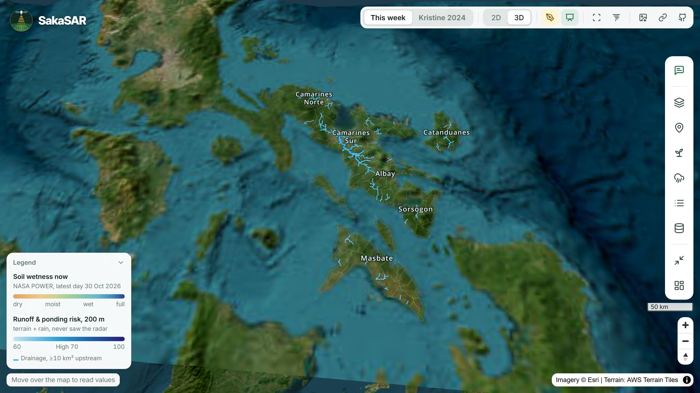
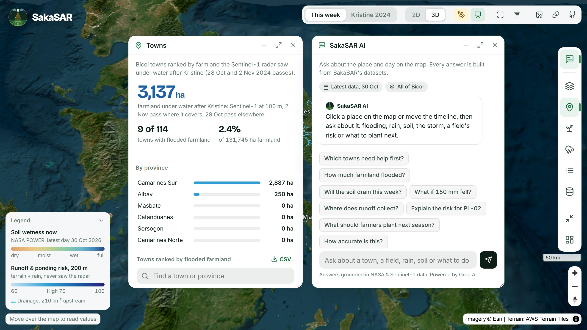
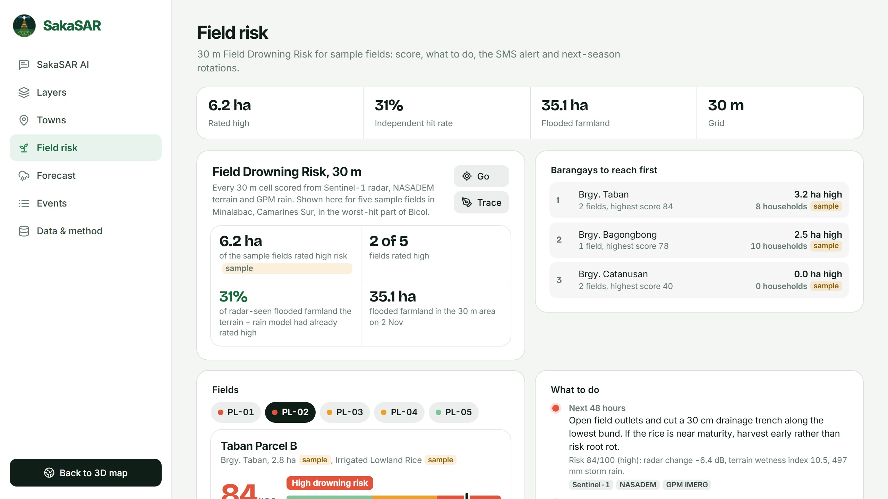
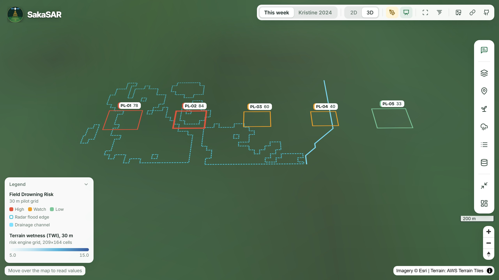
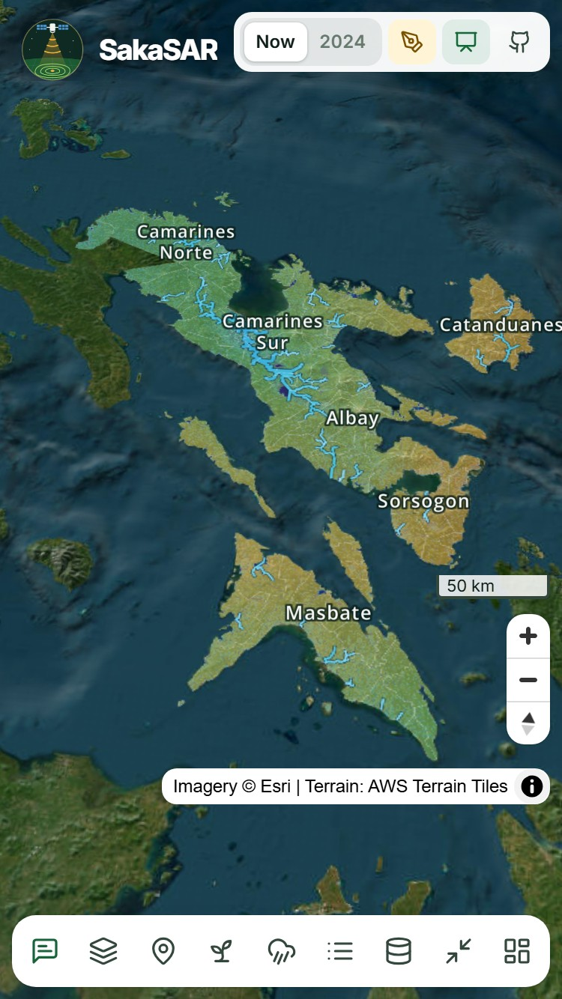
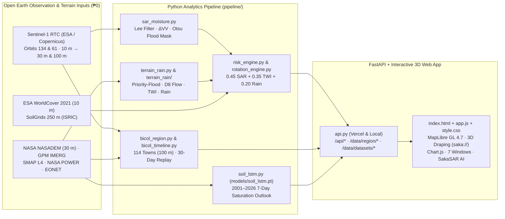

<div align="center">


# SakaSAR

### Multi-scale SAR flood mapping and short-lead soil-waterlogging forecasting for typhoon-hit farms

*Built for the 2026 NASA Space Apps Challenge — **Field Shift: Adapting Farms with NASA Data***

[](https://www.spaceappschallenge.org/)
[](https://www.spaceappschallenge.org/)
[](https://www.python.org/)
[](https://fastapi.tiangolo.com/)
[](https://maplibre.org/)
[](LICENSE)

### [▶ Open Live App — sakasar.earth](https://sakasar.earth) · [Vercel Mirror](https://sakasar.vercel.app) · [GitHub Pages Mirror](https://venstqs.github.io/SakaSAR---NASA-Space-Apps-Challenge/) · [API Docs](https://sakasar.earth/docs)

**[Problem & Impact](#-the-problem-we-solve)** ·
**[Platform Tour](#-interactive-3d-platform)** ·
**[Verified Results](#-verified-results-typhoon-kristine-octnov-2024)** ·
**[How It Works](#%EF%B8%8F-how-it-works)** ·
**[Datasets & API](#-open-datasets--api)** ·
**[Run Locally](#-run-it-yourself)** ·
**[Methods](docs/METHODS.md)** ·
**[Benchmarks](docs/BENCHMARKS.md)** ·
**[Concept → Prototype](docs/CONCEPT_TO_PROTOTYPE.md)** ·
**[Team](#-team)**

</div>

---

## In One Minute

When a typhoon hits farmland, **thick storm clouds blind optical satellites** (Landsat, Sentinel-2, MODIS) at the exact moment farmers and local governments need to know which fields are drowning.

**Sentinel-1 C-band radar sees straight through clouds and rain.** SakaSAR fuses pre- and post-storm Sentinel-1 backscatter with **NASA elevation (`NASADEM`)**, **rainfall (`GPM IMERG` & `NASA POWER`)**, **soil wetness (`SMAP` & `POWER GWETROOT`)**, **crop cover (`ESA WorldCover`)**, and **soil texture (`SoilGrids 250 m`)** to answer four operational questions at **₱0 data licensing cost**:

1. **Where did floodwater remain across all `114` Bicol municipalities (`100 m`)?** Screens **`131,745 ha`** of farmland at **`100%` radar coverage** using a multi-orbit Sentinel-1 mosaic (`28 Oct` + `2 Nov 2024`).
2. **Which specific fields need urgent action (`30 m`)?** Combines radar wetness change, terrain wetness index (`TWI`), and storm rainfall into a `0–100` drowning risk score, plain-language **48-hour farmer actions**, and **≤160-character SMS alerts**.
3. **Which barangays should field teams visit first?** Ranks municipalities and pilot barangays (`Taban → Bagongbong → Catanusan`) by high-risk farm area for Municipal Agriculture Offices and MDRRMOs.
4. **How long will roots stay waterlogged — and what should farmers plant next?** Forecasts 1–7 day root-zone saturation using a **PyTorch LSTM** trained on `25` years (`2001–2026`) of `NASA POWER` daily weather and soil wetness, paired with a three-strategy **next-season crop rotation engine**.

---

## The Problem We Solve

| Operational bottleneck | How SakaSAR addresses it |
| :--- | :--- |
| Clouds block optical imagery throughout typhoon passage | Uses **C-band SAR (`Sentinel-1 RTC`)**, penetrating cloud cover and rain bands |
| Post-storm damage assessments take weeks of manual surveys | Screens **`114` municipalities** at `100 m` and maps **`35.1 ha`** of flooded strip farmland at `30 m` automatically |
| Farmers receive broad regional bulletins without field-level guidance | Delivers per-plot **risk tiers (`High` / `Watch` / `Low`)**, **4-stage advisories**, and **≤160-char SMS alerts** |
| Local governments lack triage ordering after regional rainfall | Ranks provinces, towns (**`3,137 ha`** across **`9` towns**), and barangays by affected farmland |
| Growers lack soil-aware crop recovery plans after standing water drains | Scores **legume**, **deep-rooting biotillage**, and **short-cycle** rotations by `SoilGrids` texture, risk class, and farmer priority (`water`, `nitrogen`, `cash`) |

---

## Interactive 3D Platform

Built with **MapLibre GL JS 4.7.1**, custom `saka://` raster tile draping over 3D terrain (`AWS Terrain Tiles`), **Chart.js 4.4.1**, and **Lucide Icons** on top of a **FastAPI** backend (`api.py`):

| Full-Bleed 3D Bicol Replay (`sakasar.earth`) | Windowed AI Brief & Town Priority |
|---|---|
|  |  |
| **Main 3D workspace**: replays Super Typhoon Kristine's 6-hourly `NASA EONET` storm track (closest pass `≈259 km` from Naga on `23 Oct`), interpolated `NASA POWER` rain & root-zone wetness heatmaps, daily `NASA GIBS` layers, foldable legend, coordinate + elevation readout, timeline scrubber, and right launcher rail. | **Draggable / resizable floating windows**: pairs the deterministic, dataset-grounded **SakaSAR AI** assistant alongside the **Towns** ranking table (`3,137 ha` across `9 of 114` Bicol towns). Any window maximizes into a full-screen workspace. |

| Workspace — `30 m` Field Risk | `30 m` Terrain Wetness Index (3D Draped) |
|---|---|
|  |  |
| **Minalabac Field Risk view**: `30 m` plot risk (`PL-01`–`PL-05`, `6.2 ha` sample footprint), **`31%` independent hit rate**, `35.1 ha` observed Sentinel-1 flood, barangay triage, 4-stage actions, SMS preview, and rotation fit. | **`30 m` pilot grids (`209×164` Web Mercator cells)**: interactive `TWI` (`5.0–15.0`), risk score, risk class, `ΔVV`, and slope rasters draped onto 3D terrain alongside sample plots, observed flood outlines, and traced drainage corridor. |

| Splash Intro Screen | Mobile Responsive Layout (`390×844`) |
|---|---|
|  |  |

### Platform Windows & Tools
The right launcher rail opens seven modular windows (`index.html` / `app.js`), plus a **5-step guided Story tour** and **2D / 3D** camera toggle:
- **`SakaSAR AI`**: Rule-based Q&A assistant (`aiAnswer`) anchored directly to clicked map coordinates, timeline day, selected plot, regional stats, and LSTM outputs — never hallucinates unmeasured values.
- **`Layers`**: Toggles 3D terrain exaggeration, interpolated `NASA POWER` rain / soil wetness fields, daily `NASA GIBS` true-color/cloud tiles, Sentinel-1 flood extent, hotspot centroids, storm track, and `30 m` pilot GeoTIFF grids.
- **`Towns`**: All `114` Bicol municipalities filterable and sortable by flooded hectares (`ha`), farmland share (`%`), orbit date (`28 Oct` vs `2 Nov`), and province.
- **`Field risk`**: Deep-dive `30 m` plot inspector (`PL-01`–`PL-05`), plain-language 48-hour action, SMS alert copy, barangay visit queue, and priority-ranked crop rotations.
- **`LSTM forecast`**: Interactive root-zone soil wetness chart, Kristine hindcast verification, and scenario comparisons (`dry`, `normal`, `typhoon` week).
- **`Events`**: Chronological event feed synced to the timeline scrubber (`2024-10-10` to `2024-11-08` Philippine Time, UTC+8).
- **`Data & method`**: Transparent documentation of formulas, independent validation (`31%`), rejected scenes (`21 Oct`), sources, and known limitations.

---

## Verified Results: Typhoon Kristine (Oct–Nov 2024)

### 1. Bicol Regional Flood Screening (`100 m`, `EPSG:32651`)
Computed across all **six Bicol provinces** (**`114` municipalities**, **`131,745 ha`** of mapped cropland) using a `100%`-coverage (`1.0`) Sentinel-1 C-band mosaic merging **orbit `134`** (`2 Nov`, `τ = -15.0 dB`, Otsu `-11.83 dB`) and **orbit `61`** (`28 Oct`, `τ = -15.0 dB`, Otsu `-11.42 dB`; `650.0 s` build time):

- **Total Flooded Farmland Detected:** **`3,137 ha` (`2.4%` of mapped farmland)** across **`9` affected towns**
- **Provincial Totals:**
  - **Camarines Sur:** `2,887 ha` (`3.92%` across `37` towns)
  - **Albay:** `250 ha` (`1.26%` across `18` towns)
- **Most Affected Municipalities:**
  - **Bula** (`1,155 ha`, `20.9%`), **Baao** (`736 ha`, `27.6%`), **Nabua** (`444 ha`, `13.7%`), **Bato** (`407 ha`, `25.4%`), **Libon** (`246 ha`, `5.9%`), **Minalabac** (`73 ha`), **San Fernando** (`47 ha`), **Milaor** (`25 ha`), **Polangui** (`4 ha`)
- **30-Day Regional Timeline (`2024-10-10` to `2024-11-08`):**
  - Combines **`35`** `NASA POWER` `~50 km` grid cells and **`29`** `NASA EONET` storm track fixes (closest pass **`≈259 km` from Naga on `23 Oct 04:49 PHT`** — damage came from persistent rain bands rather than a direct eye strike)
  - **Regional LSTM Hindcast (`3 Nov 2024`):** Predicted waterlogged days within **`1` day in `28 of 31`** evaluated grid cells (`MAE 0.01`)

### 2. Minalabac Farm Pilot (`30 m`, Camarines Sur)
Fine-scale validation on rice paddies in **Brgy. Bagongbong, Taban, and Catanusan, Minalabac, Camarines Sur** (`[123.1963, 13.5384, 123.2151, 13.5448]`, Sentinel-1 relative orbit `134` descending):

| Metric | Verified Value | Details |
| :--- | :--- | :--- |
| **Headline Validation Hit Rate** | **`31%`** | Independent test using terrain + rainfall alone (**never saw the radar**). *(`100%` full-model hit rate is circular because ΔVV is in both score and mask and is kept only as a consistency check.)* |
| **Observed Flooded Farmland** | **`35.1 ha`** | Mapped in the `30 m` pilot strip on the `2 Nov` calm post-storm Sentinel-1 pass |
| **SAR Baseline & Rejection QC** | **`+0.31 dB`** (`9 Oct`) / **`+5.3 dB`** rejected (`21 Oct`) | `4`-date calm Aug–Sep baseline (`10 Aug, 22 Aug, 15 Sep, 27 Sep`). The `21 Oct` storm-peak pass is **explicitly rejected** because wind and heavy rain roughened water surfaces (`+5.3 dB` brightening across a `35 × 33 km` scan) |
| **Sample Plot Risk Scores (`PL-01`–`PL-05`)** | **`2 of 5` High** (`6.2 ha`, `18` households\*) | `PL-01` (`78` High), `PL-02` (`84` High), `PL-03` (`60` Watch), `PL-04` (`40` Watch), `PL-05` (`33` Low) · *\*Outlines, ha, and households are illustrative placeholders* |
| **LGU Barangay Visit Priority** | **Taban → Bagongbong → Catanusan** | Ranked by high-risk farmland area (`Taban 3.2 ha`, `Bagongbong 2.5 ha`, `Catanusan 0.0 ha`) |
| **Storm Rainfall** | **`497 mm`** (`GPM IMERG`) · `510 mm` (`NASA POWER`) | `469 mm` storm event + `28 mm` 7-day antecedent precipitation |
| **Soil Wetness Context** | **`+2.2σ`** (`SMAP L4`) | Event root-zone moisture anomaly vs. 30-day pre-storm baseline (`~11 km` context layer) |
| **Web Pilot Raster Grid** | **`209 × 164` cells** | Reprojected to Web Mercator (`data/region/pilot_grids.json`) for live pixel inspection & 3D draping |

### 3. LSTM Soil-Saturation Forecast (`pipeline/soil_lstm.py`)
A compact single-layer **PyTorch LSTM** (`64` hidden units, `models/soil_lstm.pt`, `82 KB`) trained on `25` years (**`9,444` daily rows, `2001–2026`**) of `NASA POWER` meteorology and MERRA-2 root-zone/surface wetness (`GWETROOT`, `GWETTOP`):

- **Chronological Split:** Trained `2001–2018`, validated `2019–2021`, tested on completely held-out **`2022–2026`** (including Typhoon Kristine)
- **Out-of-Sample Accuracy (days `+1…+7`):**
  - **`−60%` RMSE** vs. persistence (`−77%` in heavy-rain weeks `≥100 mm`)
  - **`−25%` RMSE** vs. ridge regression (`−53%` in heavy-rain weeks `≥100 mm`)
- **Typhoon Kristine Hindcasts:** Correctly predicted **`7/7` waterlogged days** during storm week (`MAE 0.002`) and **`7/7` waterlogged days** immediately after the `2 Nov` radar pass (`MAE 0.004`)

### 4. Next-Season Crop Rotation Engine (`pipeline/rotation_engine.py`)
Combines each plot's `SoilGrids 250 m` thickness-weighted texture/organic carbon (`0–30 cm`) with its drowning risk class to rate (`good` / `neutral` / `caution`) and rank three post-flood crop strategies by farmer priority (`water`, `nitrogen`, or `cash`):
- **Legume rotation** · **Deep-rooting cover crop (`biotillage`)** · **Short-cycle cash crop**

---

## System Architecture



---

## How It Works

Each `30 m` cell on `EPSG:32651` (UTM Zone 51N) receives three normalized sub-scores documented in [`docs/METHODS.md`](docs/METHODS.md):

$$S_{\text{SAR}} = \text{clip}\!\left(\frac{-\Delta\sigma^0_{\text{VV}}}{4\,\text{dB}},\, 0,\, 1\right) \qquad S_{\text{TWI}} = \text{clip}\!\left(\frac{\text{TWI} - 5}{10},\, 0,\, 1\right) \qquad S_{\text{Rain}} = \text{clip}\!\left(\frac{R}{300\,\text{mm}},\, 0,\, 1\right)$$

$$\text{RiskScore} = \text{round}\Big(100 \times \big(0.45 \cdot S_{\text{SAR}} + 0.35 \cdot S_{\text{TWI}} + 0.20 \cdot S_{\text{Rain}}\big)\Big)$$

- **Risk Tiers:** **High** (`≥ 70`), **Watch** (`40–69`), **Low** (`< 40`); built-up and permanent water cells (`ESA WorldCover 2021`) are excluded from farmland scoring.
- **Flood Detection Rule:** Post-storm backscatter $\text{VV}_{\text{after}} < \tau$ (Otsu bounded `[-20, -12]` dB, fallback `-15 dB`), $\Delta\text{VV} < -2\,\text{dB}$, slope $< 5^\circ$, and non-permanent water.

---

## Open Datasets & API

### Curated Tables ([`data/datasets/`](data/datasets/README.md))
| File | Scale | Rows | Contents |
|---|---|---|---|
| `daily_weather_soil_2001_2026.csv` | Daily time series | `9,444` | `25`-year meteorology & `GWETROOT`/`GWETTOP` soil wetness (LSTM dataset) |
| `pixels_30m_pilot.csv` | `30 m` UTM grid | `1,541` | Per-pixel `ΔVV`, `TWI`, slope, elevation, WorldCover, flood mask, full & terrain-only scores |
| `plot_features.csv` | Plot polygons | `5` | Extracted radar, terrain, soil texture (`SoilGrids`), risk score, and rotation fits |
| `plot_recommendations.csv` | Plot × stage | `20` | 4-stage farmer & extension recommendations per plot |

### Regional & Web Outputs (`data/region/`)
- `bicol_summary.json` — `114`-municipality totals, provincial summaries, top flooded towns, orbit metadata (`650.0 s`)
- `bicol_timeline.json` — `30` daily snapshots (`2024-10-10` to `2024-11-08`), `35` POWER cells, `29` EONET storm fixes, LSTM hindcasts (`28/31`)
- `bicol_municipalities.geojson` & `bicol_flood.png` — Vector town boundaries with per-town stats & `100 m` flood raster overlay
- `pilot_grids.json` — `209 × 164` scaled-integer `30 m` grids for browser rendering & coordinate inspection

### FastAPI Endpoints (`api.py`)
| Endpoint | Description |
| :--- | :--- |
| `GET /` | Interactive 3D MapLibre web dashboard |
| `GET /api/data` | Full `30 m` pilot JSON contract (`mock-data.json`) |
| `GET /api/plots` | Pilot farm polygons (`PL-01`–`PL-05`) with risk metrics (GeoJSON) |
| `GET /api/risk-map` | Map layers (`plots`, `observed_flood_extent`, `sar_backscatter_comparison`, `drainage_corridor`) |
| `GET /api/rotations?priority=water\|nitrogen\|cash` | Crop rotations ranked by farmer priority |
| `GET /api/provenance` | Scene dates, quality-control rejections, rainfall/SMAP stats, hit rates |
| `GET /api/soil-outlook` | LSTM root-zone saturation forecasts, Kristine hindcasts, and test accuracy |
| `GET /api/recommendations?plot_id=PL-01` | 4-stage action timeline per plot (or all plots) |
| `GET /api/region` | Bicol Region `100 m` flood summary across `114` towns |
| `GET /data/region/{name}` | Regional GeoJSON, JSON timelines, or PNG overlays |
| `GET /data/datasets/{name}` | Downloadable CSV datasets & documentation card |
| `GET /docs` | Interactive Swagger / OpenAPI specification |

---

## Run It Yourself

### 1. Local Server & Tests (Works Offline from Included Cache)
```bash
git clone https://github.com/venstqs/SakaSAR---NASA-Space-Apps-Challenge.git
cd "SakaSAR---NASA-Space-Apps-Challenge"

pip install -r requirements.txt
python -m pytest -q
uvicorn api:app --reload --port 8000
```
Then open **[http://127.0.0.1:8000](http://127.0.0.1:8000)** (or **[http://127.0.0.1:8000/docs](http://127.0.0.1:8000/docs)** for API exploration).

### 2. Reproduce Analytics Pipeline Modules
```bash
# 30 m SAR wetness change, terrain hydrology, risk fusion, and GeoTIFF export
python -m pipeline.risk_engine          # offline via data/cache/ (~1 s); add --refresh to fetch live STAC/NASA APIs
python -m pipeline.web_layers           # exports 30 m pilot grids to data/region/pilot_grids.json
python -m pipeline.build_datasets       # regenerates CSV tables in data/datasets/

# 100 m Bicol regional screening & EONET/POWER timeline
python -m pipeline.bicol_region
python -m pipeline.bicol_timeline

# Retrain / evaluate the PyTorch LSTM soil-saturation model (requires torch)
pip install -r requirements-ml.txt
python -m pipeline.soil_lstm
```

---

## Repository Structure

```text
├── index.html · app.js · style.css   # MapLibre 3D dashboard, 7 modular windows, Story mode, SakaSAR AI
├── api.py                            # FastAPI application (REST JSON contract + static dashboard + security allowlist)
├── pyproject.toml · requirements*.txt# Python packaging & dependencies (runtime + optional PyTorch training)
├── robots.txt · sitemap.xml          # Search engine crawl directives & sitemap for https://sakasar.earth
├── mock-data.json                    # Frozen 30 m pilot output payload served at /api/data
├── pipeline/                         # Core geospatial & ML analytics package
│   ├── sar_moisture.py               #   Sentinel-1 RTC speckle filtering, ΔVV, Otsu thresholding, flood mask
│   ├── terrain_rain.py               #   NASADEM depression filling, D8 accumulation, TWI, IMERG/POWER/SMAP
│   ├── risk_engine.py                #   Composite 0.45/0.35/0.20 risk scoring, hit rates, barangay triage
│   ├── rotation_engine.py            #   SoilGrids 250 m profiles and 3-strategy crop rotation scoring
│   ├── recommend.py                  #   4-stage farmer timelines combining radar risk + LSTM outlook
│   ├── soil_lstm.py                  #   PyTorch LSTM root-zone saturation training & hindcasts
│   ├── bicol_region.py               #   100 m Bicol-wide (114-town) Sentinel-1 mosaic & screening
│   ├── bicol_timeline.py             #   30-day NASA EONET + POWER regional timeline & cell hindcasts
│   ├── web_layers.py                 #   Web Mercator 30 m raster packaging (pilot_grids.json)
│   ├── build_datasets.py             #   Reproducible open CSV builders (data/datasets/)
│   ├── plots.geojson                 #   Pilot sample plot geometries (PL-01..PL-05)
│   └── common.py                     #   Shared EPSG:32651 30 m grid math, caching, vector helpers
├── terrain_rain/                     # Standalone 30 m terrain & rainfall preprocessing package + unit tests
├── models/soil_lstm.pt               # Pre-trained PyTorch LSTM weights (82 KB)
├── data/                             # Cached satellite inputs, raw Bicol exports, 30 m GeoTIFFs, regional JSONs, CSVs
├── assets/                           # Brand logos, favicons, and dashboard screenshots
├── docs/METHODS.md                   # Complete technical specification, formulas, validation, and caveats
├── tests/                            # Pytest suite validating API endpoints, path safety, risk math & outputs
├── CITATION.cff                      # Software citation metadata
└── LICENSE                           # MIT License
```

---

## Scientific Limits & Caveats

We explicitly document every boundary of what current open data and SakaSAR support:

- **Surface vs. root-zone physics:** C-band Sentinel-1 measures surface water and topsoil wetness, not deep root-zone soil moisture directly; standing water under a dense mature rice canopy can cause double-bounce brightening rather than darkening.
- **Timing relative to typhoon peak:** The `2 Nov` Sentinel-1 scene shows persistent flooding **`9` days after landfall** (not peak flood stage), while the storm-peak `21 Oct` pass is excluded because typhoon winds roughened water surfaces (`+5.3 dB`).
- **Storm track geometry:** Typhoon Kristine's closest pass was **`≈259 km` from Naga (`23 Oct 04:49 PHT`)**; flooding across Bicol was driven by expansive outer rain bands over already wet terrain rather than a direct eye strike.
- **Illustrative pilot boundaries:** Outlines, hectares (`6.2 ha`), household counts (`18`), crops, and bare-field days for `PL-01`–`PL-05` are representative placeholders pending Municipal Agriculture Office parcel registries and census data.
- **Expert-set weights & regional LSTM grid:** Risk weights (`0.45 / 0.35 / 0.20`) are heuristic rather than empirically fitted to insurance claims, and the LSTM learns `NASA POWER`'s `~50 km` MERRA-2 soil wetness reanalysis (`GWETROOT`) rather than in-situ paddy tensiometers.
- **Unclaimed concepts:** We do **not** claim L-band dielectric inversion, "7-day early radar flood detection," or "35–50% irrigation water savings."

### Future Work
- Integrate **NISAR L-band** for sub-canopy penetration and **`30 m` Sentinel-2 / Landsat NDVI** for field-scale crop-calendar windows.
- Calibrate risk weights against verified Municipal Agriculture Office damage reports and partner parcel polygons.
- Explore **ECOSTRESS** land-surface heat stress and **GRACE** regional groundwater recovery indicators.

---

## Team — Code2Larp

| Member | GitHub | Contribution |
| :--- | :--- | :--- |
| **Adrian Xavier Moral** | [@venstqs](https://github.com/venstqs) | Main developer & integration lead: Sentinel-1 SAR pipeline, risk engine, LSTM model, regional screening, FastAPI backend |
| **Guian Emmanuel Beriso** | [@Pudges-cmd](https://github.com/Pudges-cmd) | Terrain & rainfall hydrology package (`terrain_rain/`): NASADEM conditioning, GPM IMERG, SMAP anomaly, NASA POWER |
| **Marqus Szymon Pelagio** | [@mzep98](https://github.com/mzep98) | 3D MapLibre GIS interface, visual design, interactive demo & presentation |
| **Engr. John Roy V. Galvez** | — | Technical Mentor |

---

## References & Data Attribution

- **Earth Observation & Weather Data:**
  - [Sentinel-1 RTC](https://planetarycomputer.microsoft.com/dataset/sentinel-1-rtc) (ESA / Copernicus via Microsoft Planetary Computer)
  - [NASADEM 30 m](https://planetarycomputer.microsoft.com/dataset/nasadem) · [GPM IMERG](https://gpm.nasa.gov/data/imerg) · [SMAP L4 (`SPL4SMGP`)](https://nsidc.org/data/spl4smgp) · [NASA POWER](https://power.larc.nasa.gov) · [NASA EONET](https://eonet.gsfc.nasa.gov) · [NASA GIBS](https://earthdata.nasa.gov/eosdis/science-system-description/eosdis-components/gibs)
  - [ESA WorldCover 2021](https://esa-worldcover.org) (CC BY 4.0) · [ISRIC SoilGrids 250 m](https://soilgrids.org) (CC BY 4.0)
- **Foundational Methods:**
  - Lee, J.-S. (1980). Digital image enhancement and noise filtering by use of local statistics. *IEEE TPAMI*.
  - Otsu, N. (1979). A threshold selection method from gray-level histograms. *IEEE Trans. SMC*.
  - Beven, K. J. & Kirkby, M. J. (1979). A physically based, variable contributing area model of basin hydrology. *Hydrological Sciences Bulletin*.
  - Barnes, R., Lehman, C. & Mulla, D. (2014). Priority-flood: an optimal depression-filling and watershed-labeling algorithm. *Computers & Geosciences*.
  - Kratzert, F. et al. (2018). Rainfall–runoff modelling using Long Short-Term Memory (LSTM) networks. *Hydrology and Earth System Sciences*.

---

## Citation & License

Released under the **[MIT License](LICENSE)** © 2026 SakaSAR team (Adrian Xavier Moral, Guian Emmanuel Beriso, Marqus Szymon Pelagio). See [CITATION.cff](CITATION.cff) for structured citation metadata.
